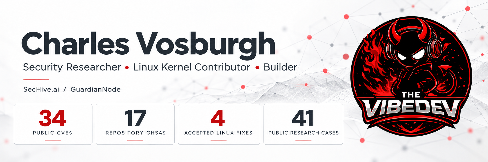

I investigate how software crosses trust boundaries—and build tools that make security research more practical, accountable, and useful.

## About me

I'm an independent, self-taught security researcher and developer. I learn by building, reading source, testing assumptions, and working with maintainers to turn findings into focused fixes.

My research spans authorization failures, sandbox escapes, parsers and deserialization, payment integrations, and kernel protocol and permission handling. I use AI-assisted development alongside hands-on source analysis and human review.

## Security research

My public work includes **34 CVEs**, **17 repository GitHub Security Advisories**, and **four accepted Linux mainline fixes**. The CVE total includes two Linux kernel findings. My kernel contributions include two authored SCTP patches and two KSMBD findings credited through `Reported-by`, with nine verified stable backports across those fixes.

I've contributed research affecting projects including **vm2, PyJWT, Apache Fory, TypeBox, isomorphic-git, fast-xml-parser, libheif, KEDA, and Yamcs**, alongside WordPress plugins and payment integrations.

| Portfolio | What you'll find |
|---|---|
| [CVE & GHSA research](https://github.com/the-vibe-dev/CVE-GHSA) | Published disclosures, root-cause analysis, affected versions, and remediation |
| [Linux kernel contributions](https://github.com/the-vibe-dev/Linux-Kernel) | Accepted patches, reported findings, mainline commits, and stable backports |

## Projects I'm building

### SecHive.ai

An operator-driven security research workbench for scoped investigations, evidence retention, reproducible analysis, and remediation review. I'm building it around deliberate scope and human-controlled disclosure decisions.

[Explore SecHive.ai](https://sechive.ai)

### GuardianNode

A local-first AI safety project for families, with a visible Windows agent, a parent-owned backend, local analysis, encrypted evidence storage, and a parent review dashboard. It's currently an **alpha / developer preview** built to support review and conversation, not replace human judgment.

[Explore GuardianNode](https://github.com/the-vibe-dev/guardiannode)

### More of my work

- [ThreatHive](https://github.com/the-vibe-dev/threathive-public) — defensive honeypot telemetry and controlled lab analysis; public alpha.
- [Dashburg](https://github.com/the-vibe-dev/dashburg-public) — a local-first control center for agents, nodes, and AI infrastructure.

## Connect

I'm interested in collaborating with maintainers, security researchers, and builders working on open-source security and practical tooling.

[LinkedIn](https://www.linkedin.com/in/charles-vosburgh/) · [Security research](https://github.com/the-vibe-dev/CVE-GHSA) · [Linux contributions](https://github.com/the-vibe-dev/Linux-Kernel) · [SecHive.ai](https://sechive.ai)

Public research totals updated October 2, 2026.
